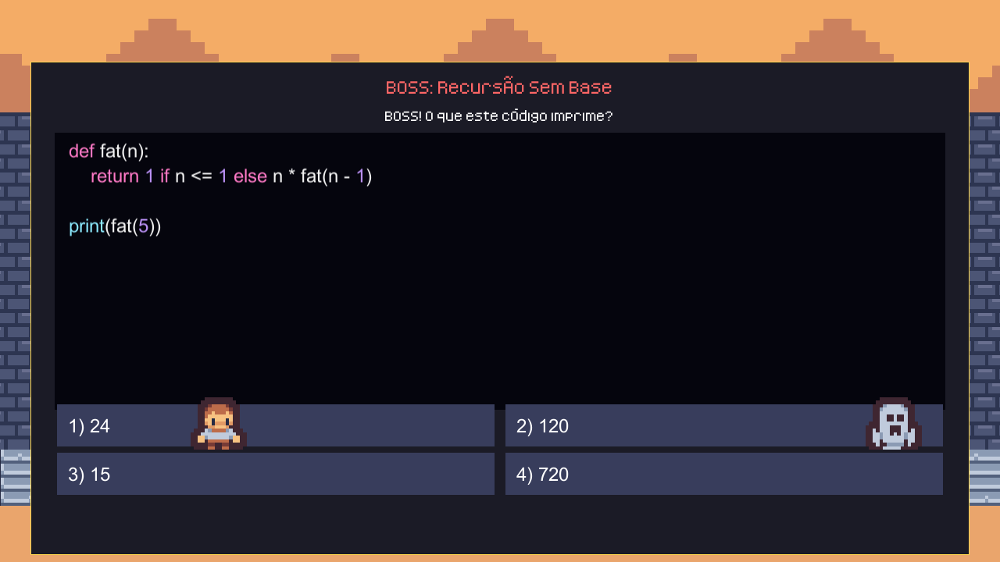

# Jornada do Dev

Jogo 2D em estilo 8-bit em que o herói sobe de carreira (Junior, Pleno e Senior) derrotando bugs com conhecimento de Python. Cada combate abre uma task de código: acertar faz o herói golpear, errar custa corações.

Projeto prático da P2 da disciplina Desenvolvimento de Jogos Digitais (Ciência da Computação, UNISAGRADO).



## Integrantes

- (preencher com o nome dos integrantes do grupo)

## Como jogar (executável)

1. Baixe o `JornadaDoDev-win64.zip` na página de releases (ou receba o arquivo da entrega).
2. Extraia o zip e execute `JornadaDoDev.exe` (Windows 64 bits).
3. Não é preciso ter Python instalado para jogar.

**Controles:** A/D ou setas para andar, Espaço para pular, clique ou teclas 1-4 para responder.

## Como abrir o projeto

1. Instale o Unity **6000.3.28f1** (Unity 6.3 LTS) pelo Unity Hub.
2. No Hub, em *Add project from disk*, escolha esta pasta.
3. Abra a cena `Assets/Scenes/MainMenu.unity` e aperte Play.

O menu **Jornada** do editor tem:

- **Gerar Cenas:** recria as 5 cenas, animações e telas a partir do código (`Assets/Editor/JornadaSceneBuilder.cs`).
- **Build Windows:** gera `Build/JornadaDoDev.exe`.
- **Capturar Telas:** salva as imagens de `docs/img`.

## Testes

```bash
bash tools/run_tests.sh EditMode   # regras: vida, banco de perguntas, combate, realce de código
bash tools/run_tests.sh PlayMode   # fase Junior: combate, game over, boss e troca de fase
py -3.14 tools/validate_questions.py Assets/Resources/Questions.json   # executa cada pergunta no Python 3.14
```

## Documentação

- [Game Design Document](docs/GDD.md)
- [Créditos e licenças dos assets](CREDITS.md)
- [Plano de implementação](docs/superpowers/plans/2026-11-18-jornada-do-dev.md)
