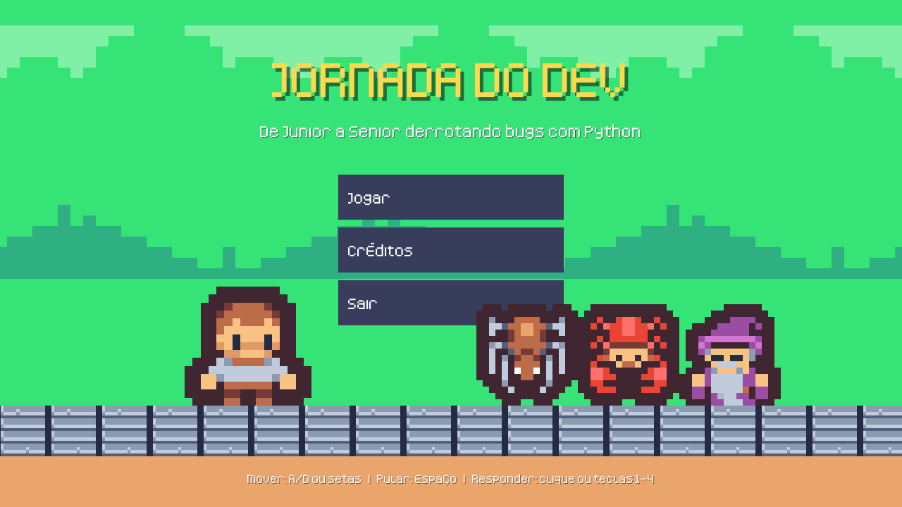
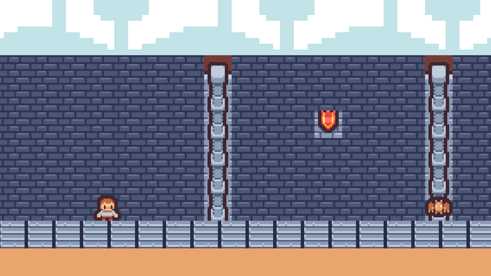
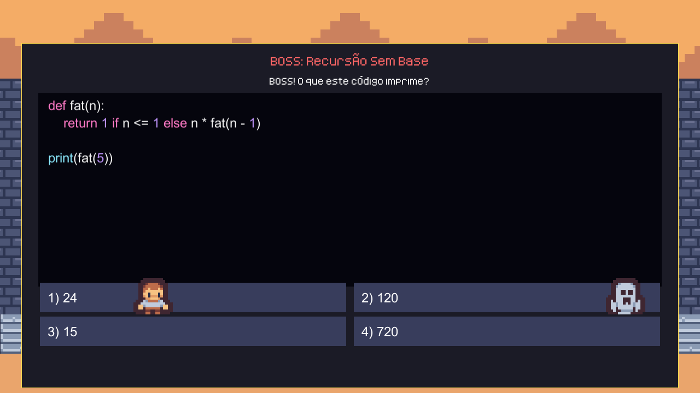

# Jornada do Dev — Game Design Document (simplificado)

## 1. Conceito

**Jornada do Dev** é um jogo 2D em estilo 8-bit para PC em que um programador iniciante sobe de carreira (**Junior → Pleno → Senior**) derrotando "bugs" em salões de um castelo. O combate não é por reflexo: cada luta abre uma **task de Python**, e o conhecimento do jogador é a arma.

- **Gênero:** plataforma 2D com combate por perguntas (quiz de programação).
- **Público:** estudantes de computação e iniciantes em Python.
- **Plataforma:** Windows (PC), teclado e mouse (gamepad para movimento).
- **Duração de uma partida:** 8 a 12 minutos.

## 2. Loop principal

1. O jogador anda pelo salão (pula obstáculos, avança para a direita).
2. Um inimigo detecta o herói, persegue e, ao encostar, **inicia o combate**.
3. Abre a task: um trecho de código Python e 4 alternativas de "o que este código imprime?".
4. **Acertou:** o herói avança e desfere um golpe (dash, corte, hit-stop, faíscas, tremor de tela, número de dano). **Errou:** o inimigo ataca, o herói perde corações e a explicação da resposta aparece.
5. Repete até o inimigo cair ou o herói ficar sem corações (**Game Over**).
6. Derrotado o boss, a porta do salão se abre e leva à próxima fase.

## 3. Controles

| Ação | Tecla |
|---|---|
| Mover | A/D ou setas (analógico no gamepad) |
| Pular | Espaço (botão A/Sul no gamepad) |
| Responder | clique na alternativa ou teclas 1 a 4 |

## 4. Fases e inimigos

| Fase | Conteúdo das tasks | Mobs (2 acertos cada) | Boss (3 acertos) |
|---|---|---|---|
| 1 — Dev Junior | operações matemáticas: precedência, `/` × `//`, `%`, `**`, `divmod`, `round` | Syntax Error | Bug do Ponto Flutuante |
| 2 — Dev Pleno | strings, listas, `if/elif`, `for`/`while`, f-strings | NullPointerException, Off-by-one | Loop Infinito |
| 3 — Dev Senior | funções, parâmetro padrão, escopo, `lambda`, comprehension, recursão, closure | Memory Leak, Race Condition | Recursão Sem Base (tira 2 corações) |

## 5. Regras de combate

- O herói tem **5 corações**, recarregados a cada fase.
- Cada acerto tira 1 de vida do inimigo; cada erro tira 1 coração (2 no boss Senior).
- As perguntas não se repetem até o banco do tier acabar; depois são reembaralhadas sem repetir a última.
- Bosses usam perguntas marcadas como `boss` (mais difíceis).
- O banco tem 30 perguntas (10 por fase) em `Assets/Resources/Questions.json`, todas conferidas executando o código no **Python 3.14** (`tools/validate_questions.py`).

## 6. Interface

- **HUD:** corações (canto superior esquerdo), nome da fase (topo) e barra de vida do inimigo durante o combate (canto superior direito).
- **Painel da task:** nome do inimigo, código com realce de sintaxe Python, 4 alternativas e feedback (acerto / explicação do erro).
- **Telas:** Menu, Game Over (tentar de novo / menu), Vitória e Créditos.

## 7. Arte e áudio

- Estilo 8-bit, sprites 16×16 com filtro *point* (sem suavização).
- Arte, fontes e sons: packs **CC0** da Kenney (Tiny Dungeon, Pixel Platformer, Impact Sounds, Interface Sounds, Music Jingles, Kenney Fonts), creditados na tela de Créditos.
- Animações: movimento, pulo, ataque, dano e morte feitos com `AnimationClip` (balanço, rotação, squash & stretch); golpes com efeitos por código.

## 8. Tópicos da disciplina aplicados

| Tópico (aulas) | Onde está no jogo |
|---|---|
| Input System com `PlayerControls` gerado | `PlayerController`, teclas 1-4 do `TaskPanel` |
| `Rigidbody2D`, ground check com `OverlapCircle`, gravidade maior na queda | `PlayerController` |
| Animator com parâmetros `Speed`, `VerticalVelocity`, `isGrounded` e triggers | controllers `Heroi` e `Inimigo` |
| Câmera com `Vector3.SmoothDamp` | `CameraController` (+ tremor de tela) |
| Fundo com `mainTextureOffset` | `BackgroundController` (parallax) |
| Máquina de estados (`State`, `Enter`, `Execute`), `Death`, `DestroyEnemy` | `EnemyController` (Patrol, Chase, Combat) |
| `SceneManager` e menu | `MenuController`, `GameManager` |
| `GameManager` singleton (`Instancia`), vida, Game Over, `Time.timeScale` | `GameManager`, hit-stop do `CombatFx` |
| Testes e refinamento | 19 testes EditMode + 4 PlayMode, validador das perguntas |

## 9. Arquitetura

- **Regras puras (C#, testáveis):** `Health`, `QuestionBank`, `CombatEncounter`, `PhaseInfo`, `PythonHighlighter`.
- **Componentes Unity:** player, inimigos, combate, efeitos, HUD e telas.
- **Cenas geradas por código:** `Jornada > Gerar Cenas` (`JornadaSceneBuilder`) recria as 5 cenas, animações e telas. `Jornada > Build Windows` gera o executável.
